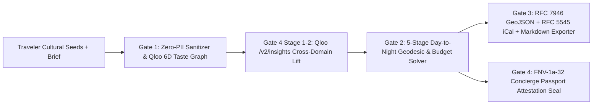

# System Architecture — VibeAtlas (Port 5186)

## Module Breakdown

1. **`src/lib/taste/qloo-taste-graph.ts`**:
   - Defines 4 global cultural corridors (`HUB-TYO-101`, `HUB-NYC-204`, `HUB-PAR-309`, `HUB-CDMX-412`), 6 cultural domains, `scrubTastePromptPii`, `computeCosineAffinity`, `computeJaccardTagOverlap`, and `computeCrossDomainAffinityScore`.
2. **`src/lib/routing/day-to-night-itinerary-solver.ts`**:
   - Computes urban Haversine distances (`computeHaversineKm`), pedestrian walk minutes (`estimateWalkMinutes`), dynamic budget/dietary venue substitutions (`solveDayToNightItinerary`), and hard invariant checks (`verifyItineraryConstraintBounds`).
3. **`src/lib/export/concierge-passport-exporter.ts`**:
   - Produces standards-compliant RFC 7946 GeoJSON (`exportItineraryGeoJson`), RFC 5545 iCalendar (`exportItineraryIcs`), and Markdown (`exportConciergeMarkdown`).
4. **`src/lib/qloo/qloo-agentic-supervisor.ts`**:
   - Executes the 4-stage agentic pipeline (`runQlooAgenticCuratorPipeline`) with a `4.5s` `AbortController` circuit breaker and FNV-1a-32 attestation (`createConciergePassportAttestation`, `verifyConciergeAttestationIntegrity`).
